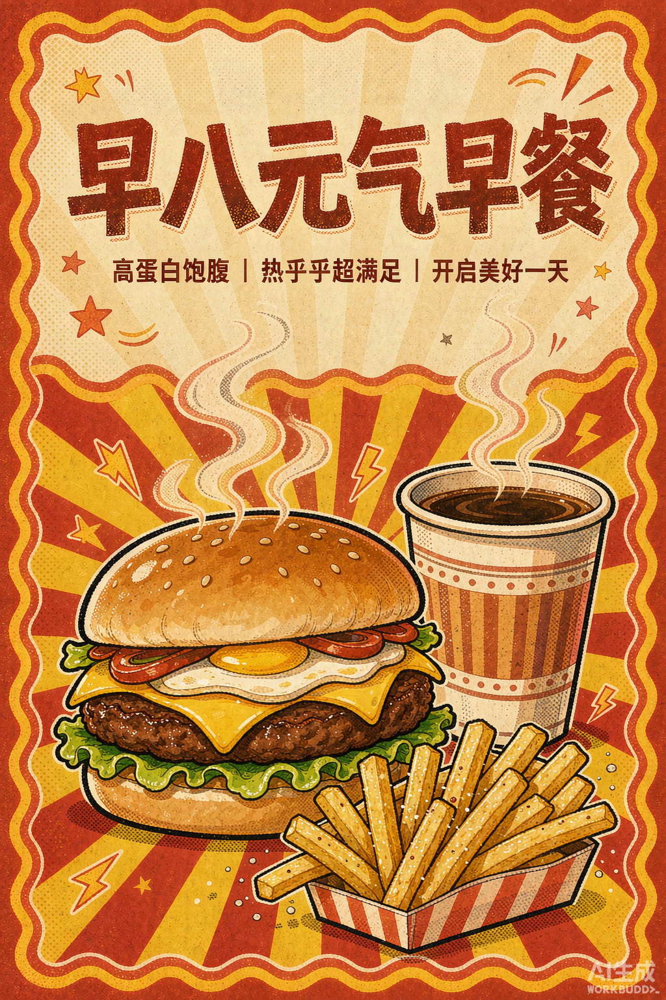

# 🎨 麦门海报工坊（MCD Poster Studio）

> 让每一次麦当劳活动，都自动长出一张能被疯转的种草海报。

基于麦当劳中国官方 MCP（Model Context Protocol）开发的内容创作 Skill：自动抓取最新活动与优惠券 → 提炼种草卖点 → 产出**可直接发布的海报物料包**（种草文案 + AI 绘图 Prompt + 排版说明 + 发布建议）。



> ⭐ 欢迎点个 Star 支持 —— 作者正备战麦当劳 Skill 开发大赛（10-25 截止），每一颗星都是实打实的助力。

## ✨ 它解决什么问题

麦当劳每月都有大量活动（限时折扣、联名周边、积分专享），但创作者要手动刷 APP、想卖点、写文案、找图、排版——往往活动结束了海报还没发出来。

**麦门海报工坊把这条链路压缩成一句话**：

```
你：「给最近的麦当劳活动做张海报」
它：物料包（文案 × Prompt × 排版 × 发布建议）—— 直接可发
```

## 🚀 安装

1. 激活麦当劳 MCP Token：打开 [open.mcd.cn/mcp](https://open.mcd.cn/mcp) → 手机号登录 → 控制台 → 激活 → 复制 Token
2. 配置 MCP（任选其一）：
   - **WorkBuddy / Claude Code 等**：将 `mcp-config.example.json` 中的 `YOUR_MCP_TOKEN` 替换为你的 Token
   - **脚本模式**：`export MCD_TOKEN=你的Token`
3. （使用 WorkBuddy）连接器 → 自定义连接器 → 配置 MCP → 粘贴配置 → 启用

## 💡 使用示例

```
「给最近的麦当劳活动做张海报」        → 自动选当前最热活动
「9.9 早餐活动，做小红书风海报」      → 指定活动 + 风格
「GD 联名棒球帽的海报，潮酷一点」     → 联名活动 + 情绪定向
「做个健康向的，突出热量数据」        → 启用营养数据卖点
```

输出物料包示例见 `SKILL.md` 的「标准输出格式」；实际生成效果见 `assets/`。

## 🎯 目标用户

- 麦门内容创作者（小红书 / 抖音探店博主）
- 本地生活运营、学生社群发起人
- 想蹭麦当劳活动热点的普通用户

> 📌 **项目定位说明**：按大赛规则（同一 GitHub 账号仅 Star 数最高的项目进入排行榜），本仓库为作者的技术展示项目。作者本次**主推的参赛项目是「麦麦治愈食堂」**——情绪陪伴 × 麦当劳的治愈食堂 Skill，欢迎前往：`https://github.com/SCY-hub123/mcd-comfort-canteen`

## 📦 项目结构

```
mcd-poster-studio/
├── README.md                  # 本文件
├── SKILL.md                   # Skill 定义（工作流 + 输出格式 + 麦门梗语料）
├── MCP_INTEGRATION.md         # MCP 接入说明（Server/Tool/流程/价值）
├── CONTEST_DECLARATION.md     # 参赛声明（官方原文）
├── mcp-config.example.json    # 脱敏 MCP 配置示例
├── workbuddy.md               # WorkBuddy 开发对话导出（专项奖励）
├── scripts/
│   └── mcd_client.py          # MCP 客户端（initialize/tools/call 封装）
├── references/
│   └── tools-cheatsheet.md    # 35 个 MCP 工具速查
└── assets/                    # 生成的海报示例
```

## 📄 License

仅供学习交流；「麦当劳」「麦门」相关商标归麦当劳中国所有。参赛声明见 [CONTEST_DECLARATION.md](CONTEST_DECLARATION.md)。
